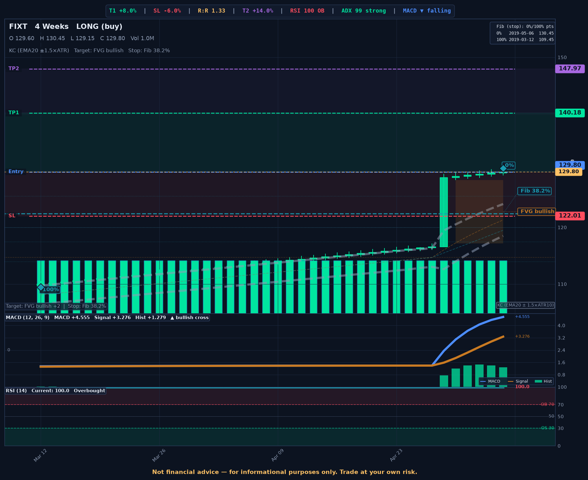
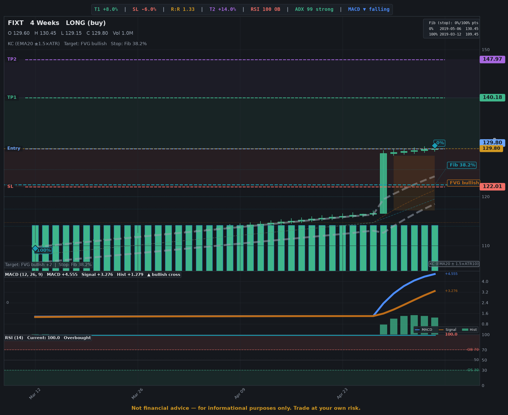

# v195 Graphite — results: alert image and layout audit

**Spec:** [2026-10-25-v195-graphite-frontend-redesign.md](../specs/2026-10-25-v195-graphite-frontend-redesign.md) Phase 6 (alert image), Phase 7 (layout audit)
**Plan:** [2026-10-25-v195-graphite-frontend-redesign_0-index.md](../plans/2026-10-25-v195-graphite-frontend-redesign_0-index.md) — V195-34 (alert image), V195-36 (layout audit, notes)

## Alert image

The same fixture (`scripts/dev/render_chart_fixtures.py`, `secondary_sources`: FVG, volume-profile and EMA targets, Fib and VWAP stops, two targets) rendered by `generate_trade_chart` before and after the palette move. "Before" is `main` at `f222f937`; "after" is the branch at `fd4e4113`.

| | Before | After |
|---|---|---|
| `STYLE_VERSION` | `v181` | `v195` |
| Ground (`bg`) | `#070b14` | `#0d0f12` |
| Gain / loss (`pos` / `neg`) | `#00e5a0` / `#ff4d5e` | `#3fb68b` / `#f06e66` |
| Entry line (`ENTRY_COLOR`) | `#4c8dff` (`chart-1`) | `#6ea8fe` (`accent`, the app's entry colour) |
| File (SHA-256, first 16) | [`v195/alert-before.png`](v195/alert-before.png) (`eef2b01820d56911`) | [`v195/alert-after.png`](v195/alert-after.png) (`5b3fc0972ff9ef52`) |

What changed, read off the two images: the ground moves from a blue-black navy to a neutral graphite, and the candles, volume bars, target and stop lines drop from saturated neon mint and red to the calmer Graphite gain and loss hues, so the TP/SL bands and the chart read quieter against the ground. The entry tag is the lighter steel blue `#6ea8fe`; target lines stay dashed green and the stop dashed red. Nothing reads worse; the amber current-price tag sits next to the blue entry tag in both images (unchanged by v195).

The chart cache keys fold in `STYLE_VERSION` (`swingbot/core/charts/cache.py`), so the bump invalidates the old images by itself and a rollback reads the old keys again (spec § Rollback).

## Layout audit

(Filled by V195-36.)

## Notes

- Charts outside Phase 6's list: `ui/bar-list.ts` and `ui/share-bar.ts` still set their `n` counts in `--text-faint` (correction 13 makes it a rule colour); `ui/scatter.ts` was not scanned. Follow-up, not v195 scope.
